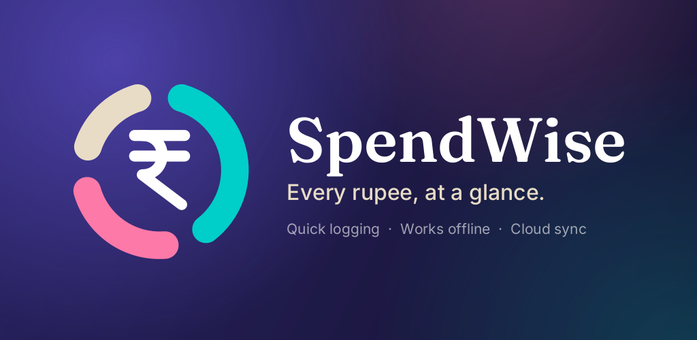
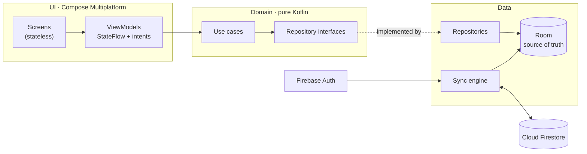

<p align="center">
  
</p>

<h1 align="center">SpendWise</h1>

<p align="center">
  <b>A calm, private expense tracker for Android and iOS.</b><br>
  One Kotlin codebase, offline-first, with optional cloud sync.
</p>

<p align="center">
  
  
  
  
  
</p>

---

## Highlights

- **Log an expense in seconds.** Amount, category, note, date and time, and payment method. The last-used category is remembered.
- **Understand your day.** A daily report with a category donut, hourly spending, top categories, the largest expense, and comparisons with the previous day and your 30-day average.
- **Offline-first.** Everything is stored on the device and works without a connection. Sign in (Google, Apple on iPhone, or email) only if you want backup and sync across devices.
- **Built for India.** Rupee amounts with Indian digit grouping (₹1,23,456) and ready-made categories you can rename, recolour or archive.
- **Private by design.** No ads, no analytics, no SMS reading. Each user can only access their own data, and accounts can be deleted in-app along with all their data.
- **Two distinct looks.** *Aurora* (light): a soft mesh gradient, frosted-glass cards and a floating glass navigation bar. *Quiet Luxury* (dark): warm charcoal with champagne and brass accents.
- **Gentle reminders.** An optional end-of-day nudge (9:30 PM by default) to log the day's spending.

## Architecture

SpendWise shares over 90% of its code between Android and iOS, including the UI. Each platform adds only a thin layer for sign-in sheets, notifications and file locations.



- **Clean layering.** The domain layer has no Room, Firebase, Compose or platform imports. Features depend on the domain and the design system, never on each other.
- **Unidirectional data flow.** Each screen is a stateless composable driven by a `ViewModel` that exposes `StateFlow<UiState>` and handles `Intent`s. One-off events go through an effects channel.
- **Replaceable backend.** All Firebase code sits behind two interfaces (`AuthRepository`, `SyncRemoteDataSource`). Without a Firebase config, the app runs fully in offline mode.

### How sync works

- **Room is the source of truth.** The UI only reads the local database, so the app is instant and works offline.
- Every change is stamped (`updatedAt`, device ID) and queued as **pending**. Deletes are soft (tombstones), so they sync too.
- **Push, then pull**, using a **server-timestamp cursor**, so clock differences between devices never cause missed changes.
- **Deterministic conflict resolution:** last write wins per record; on an exact tie a delete beats an edit, then the device ID decides. Every device reaches the same result.
- Sync runs shortly after each change, on sign-in, when the app returns to the foreground, periodically while it's open, and in the background on Android (WorkManager).
- **Firestore layout:** `users/{uid}/expenses/{id}` and `users/{uid}/categories/{id}`, protected by [security rules](firebase/firestore.rules) that validate every write and allow access only to the owner.

## Tech stack

| Area | Technology |
|---|---|
| Language and build | Kotlin 2.4, Kotlin Multiplatform, AGP 9, Gradle 9 |
| UI | Compose Multiplatform 1.12 with Material 3, custom Canvas charts (donut, bars) |
| Glass effects | [Haze](https://github.com/chrisbanes/haze) blur on Android and iOS |
| Local database | Room 3 (KMP) with bundled SQLite and exported schema history |
| Settings | DataStore Preferences (KMP) |
| Dependency injection | Koin 4 |
| Navigation and lifecycle | JetBrains builds of AndroidX Navigation and Lifecycle |
| Backend | Firebase Auth and Cloud Firestore via [GitLive firebase-kotlin-sdk](https://github.com/GitLiveApp/firebase-kotlin-sdk) |
| Background work | WorkManager (Android), local notifications (iOS) |
| Dates and time | kotlinx-datetime, `kotlin.time` |

## Testing

55 tests run on the JVM in about 30 seconds, and the common tests also run on the iOS simulator:

- **Money:** input parsing, Indian digit grouping, compact labels.
- **Daily report:** totals, category shares, hourly buckets, time zones, 30-day average, day-over-day comparison.
- **Database:** search, time windows, soft delete and restore, default category seeding, against a real in-memory Room database.
- **Sync:** multi-device push and pull, first sign-in upload, last-write-wins on every device, deletion propagation, retry after failure, account isolation, tombstone cleanup.
- **Account deletion:** cloud data, account and local copy are removed, and nothing is lost if any step fails.
- **Dependency graph:** every ViewModel can be created, which catches wiring mistakes before they reach a device.

```bash
./gradlew :shared:jvmTest
```

## Project structure

```
SpendWise/
├── androidApp/        Android entry point: Application, MainActivity, manifest, icons
├── shared/            Kotlin Multiplatform library with almost all the code
│   ├── commonMain/    app/ (navigation, DI) · core/ (domain, data, database, design system) · feature/ (screens)
│   ├── mobileMain/    Firebase implementations (Android + iOS)
│   ├── androidMain/   Android specifics: WorkManager, Credential Manager sign-in
│   ├── iosMain/       iOS specifics: notifications, native sign-in bridge
│   └── schemas/       Room schema history
├── iosApp/            SwiftUI host app, generated with XcodeGen
├── firebase/          Firestore security rules
├── docs/              Privacy policy, account deletion page, development guide
└── tools/app-icon/    Generator for the app icon and store graphics
```

## Getting started

1. Open the project in **Android Studio** (a version with AGP 9 support) and let Gradle sync.
2. Run the **androidApp** configuration on a device or emulator.

The app works out of the box in offline mode. To enable sign-in and sync, add your own Firebase project. Firebase setup, running on iOS, releasing and troubleshooting are covered in the **[development guide](docs/DEVELOPMENT.md)**.

## Privacy

- [Privacy policy](https://surajsalunke042.github.io/Spendwise-privacy/privacy-policy.html)
- [Delete your account](https://surajsalunke042.github.io/Spendwise-privacy/delete-account.html)

## Credits

Fonts: [Fraunces](https://github.com/undercasetype/Fraunces) and [Inter](https://github.com/rsms/inter), under the SIL Open Font License (see [`third_party_licenses/`](third_party_licenses)). Icons: Material Symbols (Apache 2.0).

---

<p align="center">Built by <b>Suraj Salunke</b> · <a href="mailto:surajsalunkedev@gmail.com">surajsalunkedev@gmail.com</a></p>
